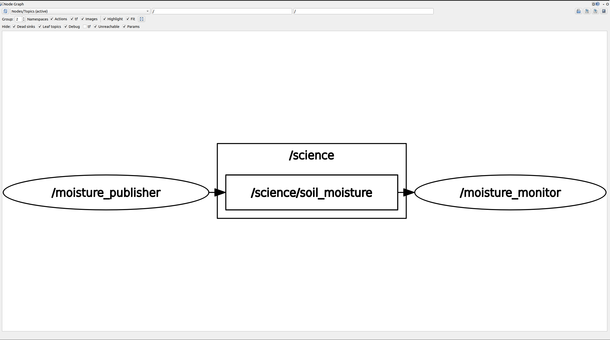

# Soil Moisture ROS 2 Demo

A ROS 2 Humble publisher/subscriber pair that simulates the soil moisture sensor on the rover's science module.

* `soil_interfaces`: custom `SoilMoisture` message (header, sensor ID, raw ADC value, moisture percent)
* `soil_moisture`: two Python nodes
  * `moisture_publisher` simulates a capacitive sensor and publishes readings on `/science/soil_moisture`
  * `moisture_monitor` subscribes, labels each reading DRY / OK / SATURATED, and logs a running average

## Build

```bash
source /opt/ros/humble/setup.bash
cd soil_ws
colcon build
source install/setup.bash
```

## Run

Two terminals (source `install/setup.bash` in each):

```bash
ros2 run soil_moisture moisture_publisher
ros2 run soil_moisture moisture_monitor
```

Or both at once:

```bash
ros2 launch soil_moisture soil_demo.launch.py
```

## Useful checks

```bash
ros2 topic list
ros2 topic echo /science/soil_moisture
ros2 interface show soil_interfaces/msg/SoilMoisture
rqt_graph
```

Parameters can be changed at runtime, for example:

```bash
ros2 run soil_moisture moisture_publisher --ros-args -p sensor_id:=probe_2 -p publish_rate_hz:=5.0
```

## rqt_graph


